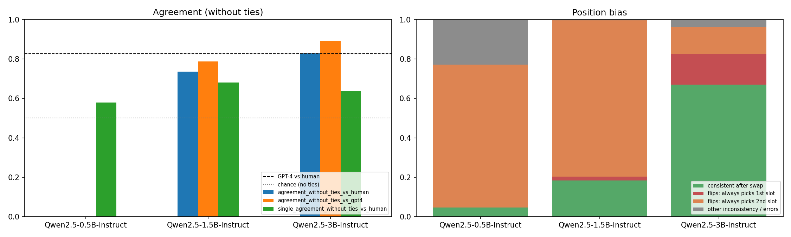
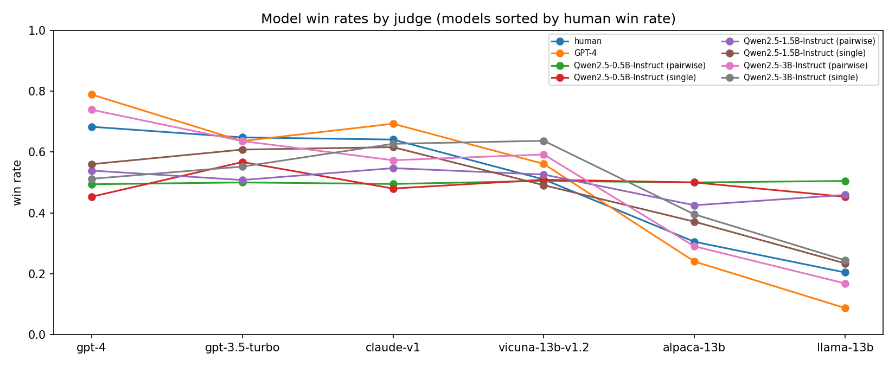

# LLM-as-a-Judge: How Reliable Are Small Open Models as Evaluators?

Human evaluation of chatbot answers is slow and expensive, so strong LLMs (usually GPT-4) are now
widely used to grade other models. This project tests whether **small open-weight models
(Qwen2.5 0.5B / 1.5B / 3B)** can do that job. Each judge's verdicts are compared against
**human experts** and against **GPT-4**:

1. **Agreement:** how often does a small judge agree with experts and with GPT-4, and how does that scale with size?
2. **Biases:** position bias, verbosity bias and format failures.
3. **Protocol:** pairwise comparison vs. single-answer 1–10 grading.
4. **Ranking:** would the small judge's verdicts reproduce the human leaderboard of chatbots?

## Dataset: `LLM_judge_dataset.xlsx`

A 1,000-row slice of the **MT-Bench** judgement data (Zheng et al., 2023), with two sheets:

| Sheet | Rows | Content |
|---|---:|---|
| `human` | 1,000 | Expert votes (63 annotators) comparing answers from GPT-4, Claude-v1, GPT-3.5-turbo, Vicuna-13B, Alpaca-13B and LLaMA-13B on 24 two-turn questions (writing, roleplay, reasoning) |
| `gpt4_pair` | 1,000 | GPT-4-as-a-judge verdicts, covering every pair in the `human` sheet |

Votes on the same pair (shown in either order) are merged into **544 unique answer pairs**
(272 at turn 1, 272 at turn 2) and aggregated by majority vote; a split vote is a tie. Each pair is
matched to its GPT-4 verdict. GPT-4's `tie (inconsistent)` means GPT-4 itself flipped when the
answers were swapped, and is counted as a tie.

**Reference points computed from the dataset itself** (all 544 pairs):

| Agreement | With ties | Without ties |
|---|---:|---:|
| GPT-4 vs. human majority | 0.653 | 0.837 |
| Human vs. human (two experts on the same pair) | 0.622 | 0.755 |

GPT-4 agrees with the expert majority more often than two experts agree with each other. That is
the bar a small judge is measured against.

## Method

- **Pairwise comparison with position swap.** The judge sees the question and two answers and
  outputs `[[A]]`, `[[B]]` or `[[C]]` (tie), using the MT-Bench judge prompt. Every pair is judged
  as (A, B) and as (B, A), and a verdict counts only if it survives the swap; otherwise it is a tie.
- **Multi-turn judging.** For turn-2 pairs the judge sees both full two-turn conversations and is
  told to focus on the answer to the second question (MT-Bench's multi-turn prompt).
- **Single-answer grading.** Each answer is also scored 1–10 independently, and a pairwise verdict
  is derived from the two scores.
- **Leaderboard reconstruction.** Each chatbot's win rate (win = 1, tie = ½) is computed from human,
  GPT-4 and small-judge verdicts, and the rankings are compared with Spearman's ρ and Kendall's τ.

| Metric | Meaning |
|---|---|
| `agreement_without_ties_vs_{human,gpt4}` | Agreement on pairs where neither side said tie (MT-Bench's headline number) |
| `agreement_with_ties_vs_*`, `cohen_kappa_vs_*` | 3-way agreement and chance-corrected agreement |
| `agreement_with_ties_no_swap_vs_human` | Agreement using only the first ordering, i.e. what swapping buys |
| `position_consistency` | Share of pairs whose verdict survives swapping the answers |
| `inconsistent_prefers_first/second_slot` | Among order-dependent verdicts, how often the judge just picked the 1st / 2nd shown answer |
| `judge_picks_longer` vs `human_picks_longer` / `gpt4_picks_longer` | Verbosity bias relative to humans and GPT-4 |
| `single_agreement_*`, `single_tie_rate` | Agreement of 1–10 grading, and how often both answers get the same score |
| `parse_error_rate` | Outputs that didn't follow the required format |

## How to run

Everything (code, explanations, results and charts) is in a single notebook: **[`llm_as_a_judge.ipynb`](llm_as_a_judge.ipynb)**.

1. Put `LLM_judge_dataset.xlsx` next to the notebook. On Colab the notebook asks you to upload it; on Kaggle it is found automatically under `/kaggle/input`.
2. Open the notebook in Jupyter, VS Code or Google Colab (*Runtime → Change runtime type → GPU*).
3. Adjust the configuration cell if needed (judges, number of pairs `n`), then *Run all*.

By default 300 of the 544 pairs are judged by three judges (set `n=None` for all). The 3B judge
takes the longest, because turn-2 prompts contain two full conversations.

Outputs go to `results/`: `summary.md`, `reference_agreement.csv`, `agreement_by_turn.csv`,
`agreement_by_category.csv`, `leaderboard.md`, charts, and one JSONL per judge with every raw judgement.

## Results

**Setup:** 300 of the 544 answer pairs (157 turn-1, 143 turn-2; 129 roleplay, 127 writing, 44
reasoning), judged by Qwen2.5-Instruct 0.5B / 1.5B / 3B with greedy decoding on a Kaggle GPU. Each
pair is judged in both orders, plus 1–10 single-answer grading. On these 300 pairs the human majority
is A 116 / B 110 / tie 74.

### Agreement with humans and with GPT-4

| Judge | Agreement w/o ties vs. human (n) | Agreement with ties vs. human | Kappa vs. human | Agreement w/o ties vs. GPT-4 | Tie rate |
|---|---:|---:|---:|---:|---:|
| Qwen2.5-0.5B | – *(n = 1)* | 0.243 | −0.006 | – | 99% |
| Qwen2.5-1.5B | 0.737 *(n = 38)* | 0.283 | 0.018 | 0.787 | 82% |
| **Qwen2.5-3B** | **0.828** *(n = 157)* | 0.540 | 0.311 | **0.893** | 34% |
| *GPT-4 (reference, same pairs)* | *0.827 (n = 208)* | *0.647* | *0.449* | – | *13%* |
| *Human vs. human (all pairs)* | *0.755* | *0.622* | – | – | – |

### Bias and reliability

| Judge | Position consistency | Flips that pick the **2nd** slot | Flips that pick the 1st slot | Picks longer answer (judge / human / GPT-4) | Pairwise parse errors | 1–10 rating parsed |
|---|---:|---:|---:|---:|---:|---:|
| Qwen2.5-0.5B | 4.7% | 76% | 0% | 1.00 / 0.70 / 0.77 | 71.7% | 63% |
| Qwen2.5-1.5B | 18.3% | **97%** | 2% | 0.87 / 0.70 / 0.77 | 0% | 69% |
| Qwen2.5-3B | **67.0%** | 41% | 47% | **0.76** / 0.70 / 0.77 | 0.7% | 54% |

### Breakdown for the 3B judge (agreement w/o ties vs. human, n in brackets)

| Group | Qwen2.5-3B | GPT-4 | 3B tie rate |
|---|---:|---:|---:|
| Turn 1 | 0.875 (88) | 0.856 (111) | 31% |
| Turn 2 | 0.768 (69) | 0.794 (97) | 37% |
| Writing | 0.825 (63) | 0.739 (88) | 35% |
| Roleplay | 0.868 (76) | 0.887 (97) | 31% |
| Reasoning | 0.667 (18) | 0.913 (23) | 36% |

### Leaderboard reconstruction (win rates; Spearman ρ vs. human ranking)

| Model | Human | GPT-4 | 3B pairwise | 1.5B single | 1.5B pairwise |
|---|---:|---:|---:|---:|---:|
| gpt-4 | **0.683** | **0.789** | **0.739** | 0.560 | 0.539 |
| gpt-3.5-turbo | 0.648 | 0.636 | 0.636 | 0.608 | 0.508 |
| claude-v1 | 0.641 | 0.693 | 0.573 | **0.616** | **0.547** |
| vicuna-13b-v1.2 | 0.510 | 0.561 | 0.592 | 0.491 | 0.526 |
| alpaca-13b | 0.305 | 0.240 | 0.290 | 0.371 | 0.425 |
| llama-13b | 0.204 | 0.087 | 0.168 | 0.234 | 0.459 |
| **Spearman ρ vs. human** | – | **0.943** | **0.943** | 0.771 | 0.657 |

Other judges: 3B single grading ρ = 0.429, 0.5B single ρ = 0.116. The 0.5B pairwise ranking
(ρ = −0.765) is noise, because it gave a decisive verdict on only 2 of 300 pairs.

## Analysis

**1. Reliability appears suddenly between 1.5B and 3B.** The 0.5B judge is unusable. It breaks the
output format in at least one of the two orderings on 72% of pairs and, when it does answer, picks whichever answer is shown second, so
after swapping it ends up at "tie" on 298 of 300 pairs. The 1.5B judge always produces a parseable
verdict, but in 89% of forward passes it says "B": it nearly always prefers the **second** answer it
sees. Only 18% of its verdicts survive the swap. The 3B judge is the first that actually compares
the answers: 67% of its verdicts are position-consistent, and its remaining flips split evenly
between the first and second slot (47% / 41%), i.e. noise rather than a systematic slot preference.

**2. When the 3B judge commits, it is as accurate as GPT-4, but it commits less often.** On pairs
where it gives a decisive verdict, the 3B judge agrees with the human majority **82.8%** of the time,
the same as GPT-4 (82.7%) and above the 75.5% agreement between two human experts. It agrees with
GPT-4 itself 89.3% of the time. The catch is coverage. The 3B judge returns a tie on 34% of pairs
(GPT-4: 13%), so of the 226 pairs where humans had a clear winner it picks the right one in 130
(58%), against 172 (76%) for GPT-4. This also shows in the 3-way metrics (agreement with ties 0.54
vs. 0.65, kappa 0.31 vs. 0.45). The swap rule makes the 3B judge a *precise but cautious* judge:
it abstains when unsure instead of guessing.

**3. Swapping is what makes the small judge trustworthy.** Using only one ordering, the 3B judge
agrees with humans 72–74% of the time (without ties). Requiring the verdict to survive the swap
raises that to 82.8%. Position-inconsistent verdicts are exactly the unreliable ones, and filtering
them out removes most errors. For the 1.5B judge, single-order judging would mostly measure which
answer happened to be shown second.

**4. Verbosity bias is close to GPT-4's.** Humans picked the longer answer 70% of the time and GPT-4
77%. The 3B judge sits at 76%, about the same as GPT-4. The smaller judges prefer longer answers more
strongly (87% and 100%), consistent with them reacting to surface features rather than content.

**5. Weakest on reasoning and on turn 2.** The 3B judge matches or beats GPT-4 on writing (0.83 vs.
0.74) and turn-1 questions, but falls behind on reasoning (0.67 vs. 0.91) and on turn 2, which
requires following a two-turn conversation (0.77 vs. 0.79). Reasoning questions need the judge to
solve the problem to know which answer is right, which a 3B model often cannot do. Note that the
reasoning group is small (n = 18).

**6. Pairwise beats single-answer grading for ranking.** Single 1–10 grading is unreliable at this
scale. The ratings could not be parsed for 31–46% of answers, and the small judges collapse onto
one score (0.5B gives 9/10 to most answers, 1.5B gives 7). For the 3B judge, pairwise verdicts
reproduce the human leaderboard almost exactly: **Spearman ρ = 0.943, the same as GPT-4**, with
GPT-4 ranked first and Alpaca/LLaMA last. Single grading for the same model only reaches ρ = 0.43.
The only notable swap is Claude-v1 vs. Vicuna, which are close in human win rate anyway. The 1.5B
judge does better with single grading (ρ = 0.77) than pairwise (0.66), because its pairwise mode is
dominated by position bias.

**Takeaway:** a 3B open model with swap-debiased pairwise judging can stand in for GPT-4 when
**ranking** models and when its non-tie verdicts are used, but it abstains on a third of comparisons
and is weak on reasoning questions. Below ~3B, judges are dominated by position bias and format
failures.

## Limitations

- 300 pairs, 24 questions, 3 categories (no math or coding), English only. Several breakdown cells
  have small n (e.g. reasoning: 18 decided pairs).
- Many pairs have a single expert vote, so the "human majority" is noisy (human–human agreement is 0.755 without ties).
- Agreement without ties is measured on each judge's own non-tie subset, so judges that abstain
  more are compared on easier pairs. Read it together with the tie rate and the with-ties metrics.
- Single-answer ratings were often unparseable (format not followed, or the explanation used up
  the 320-token budget), which penalises single grading. A stricter prompt or a larger budget would help.
- One prompt, greedy decoding, and judges from a single model family.

## Next steps

- Larger judges (Qwen2.5-7B) and other families (Llama-3.2-3B, Gemma-2-2B), to see where position bias disappears.
- Few-shot or reference-guided prompts for reasoning questions (MT-Bench's reference-guided judging).
- Calibrated abstention: tune when to trust a decisive verdict, trading coverage against accuracy.

## References

- Zheng et al., *Judging LLM-as-a-Judge with MT-Bench and Chatbot Arena*, NeurIPS 2023. [arXiv:2306.05685](https://arxiv.org/abs/2306.05685)
- Original data: [`lmsys/mt_bench_human_judgments`](https://huggingface.co/datasets/lmsys/mt_bench_human_judgments)

---
*Developed as part of the Large Language Models course, University of Tehran (Spring 2026).*
